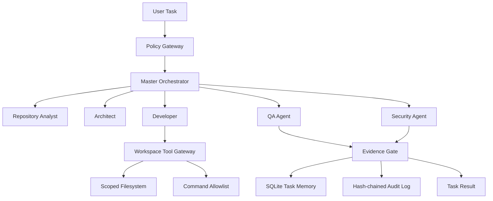

# RUSA-AI — AI Coding Agent Specification

**Version:** 1.1.0 | **Status:** Implementation contract | **Architecture:** Hierarchical enterprise multi-agent

## Mission

RUSA-AI AICode inspects a repository, plans scoped changes, implements through a constrained tool gateway, verifies with real commands, and returns auditable evidence. Full autonomy applies only to allowlisted repository work. Merge, deploy, release, production writes, destructive operations, secret changes, permission changes, and security-control changes remain approval-gated or prohibited.

## Architecture



## Agent roles

| Role | Responsibility | Authority |
|---|---|---|
| Master orchestrator | Owns task lifecycle, scheduling, and evidence gate | Coordinates only |
| Analyst | Inspects requirements and repository context | Read-only |
| Architect | Proposes minimal design and impact | Read-only |
| Developer | Produces scoped file and command actions | Workspace gateway only |
| QA | Executes tests/lint/build and records exit codes | Allowlisted commands |
| Security | Checks policy and tool boundaries | Read-only; can block |

## Autonomy policy

Allowed by default: repository reads, workspace writes, tests, lint, builds, audit reads, and task artifacts. Prohibited: secret exfiltration, disabling audit, privileged execution, force-pushing the default branch. Approval required: merge, deploy, release, production writes, destructive operations, secret or permission changes, dependency installation, and non-local network access. Unknown actions are denied.

## Tool gateway

- Paths are relative to a pre-created isolated checkout. Absolute paths, traversal, and symlink writes are denied.
- Commands execute as argument arrays without a shell, with a minimal environment, timeout, bounded output, and allowlist.
- Network is denied by default. Provider access is configured separately.
- Never pass production credentials to the agent. Never put secrets in prompts, memory, logs, or repository files.
- The Python gateway is defense-in-depth, not a substitute for OS/container sandboxing.

## Provider configuration

The runtime supports an OpenAI-compatible chat-completions endpoint using `RUSA_AGENT_BASE_URL`, `RUSA_AGENT_MODEL`, and `RUSA_AGENT_API_KEY`. Remote endpoints must use HTTPS. Configure provider timeout and output limits. Do not accept arbitrary provider URLs from task content.

## Lifecycle

`received → observing → planning → executing → verifying → succeeded | blocked | failed`

Terminal states cannot transition. A task succeeds only when automated checks return exit code zero and evidence is persisted. Model-generated claims are not verification evidence.

## Memory and audit

Task memory is SQLite-backed, repository-scoped, and size-bounded. Audit events are append-only JSONL with a hash chain. Multi-replica or regulated deployments must replace local files/SQLite with managed persistence and centralized immutable audit storage.

## Run

```bash
export RUSA_AGENT_BASE_URL=https://your-approved-provider.example/v1
export RUSA_AGENT_MODEL=your-approved-model
export RUSA_AGENT_API_KEY='injected-from-secret-manager'
python -m rusa_agents.cli \
  --workspace /isolated/worktree \
  --repository StrategyG/RusaAi \
  --work-branch feature/my-task \
  --objective 'Implement the requested feature' \
  --criteria 'Tests pass' \
  --criteria 'Security checks pass'
```

Install runtime and development dependencies using the repository manifests. Do not execute the agent against a production checkout.

## Production release gates

Require OS/container sandboxing, secret-manager integration, tenant-aware managed persistence, distributed queue and idempotency, provider allowlisting, observability/alerting, model/tool evaluation, adversarial prompt-injection tests, load/soak tests, backup/restore drills, rollback, staging canary, SLOs, and owner approval. Green unit tests alone are not production certification.
