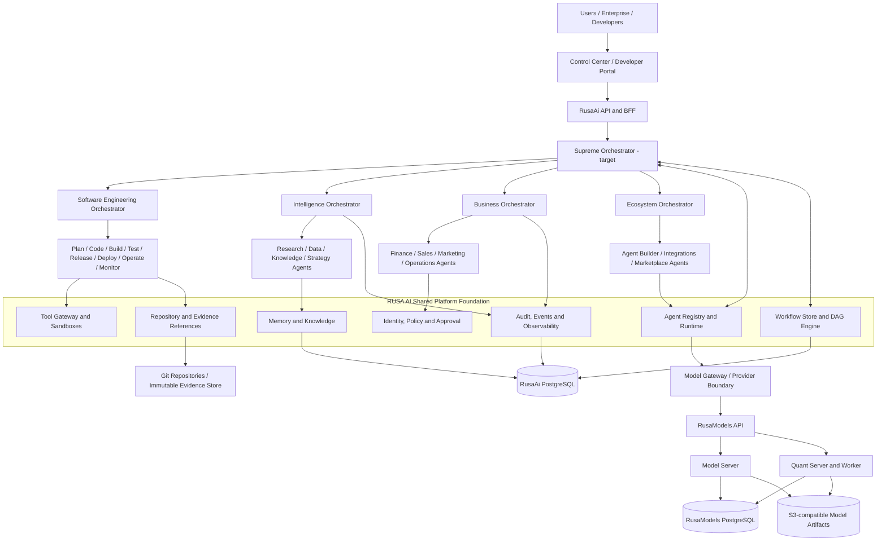

# RUSA AI Platform Architecture 2.0

**Status:** Proposed target architecture  
**Version:** 2.0-draft  
**Date:** 10 November 2026  
**Baseline:** main at c2866e2d9747b9de4ea9d5f9696b8ded11121006  
**Scope:** RusaAi platform, RusaModels integration, and the four RUSA AI product domains

> This document separates verified repository capabilities from proposed platform capabilities. A target component is not considered implemented until it has a runtime registration, an API or execution contract, tests, operational evidence, and documentation.

## 1. Executive direction

RUSA AI is evolving from an autonomous coding-agent platform into a governed, multi-domain agent platform for:

1. **Software Engineering & DevOps** — plan, build, test, release, deploy, operate, and monitor software.
2. **RUSA Intelligence** — research, reasoning, knowledge, data analysis, and decision support.
3. **RUSA Business** — governed automation and intelligence for business operations.
4. **RUSA Ecosystem** — agent development, integrations, developer APIs, and marketplace capabilities.

The target is **one shared platform foundation with multiple domain orchestrators and specialist agents**. The platform must not become four disconnected products or one unrestricted general-purpose agent.

## 2. Scope and non-goals

### Goals

- Preserve and extend the current RusaAi runtime rather than replacing it wholesale.
- Introduce a stable, versioned agent and workflow contract that supports multiple domains.
- Separate global orchestration, domain orchestration, specialist execution, and deterministic policy enforcement.
- Reuse identity, tenant isolation, model access, memory/knowledge, tools, evidence, audit, and observability across domains.
- Keep RusaModels as an independent model-infrastructure service boundary.
- Make autonomy bounded, observable, recoverable, and evidence-based.

### Non-goals for this phase

- Do not claim that the ten core agents or eight DevOps lifecycle agents are already running.
- Do not introduce RabbitMQ, Kafka, gRPC, or WebSocket merely to match a target diagram.
- Do not rewrite the existing AICode runtime or change its public API without a compatibility plan.
- Do not merge RusaModels database or object-storage access into RusaAi.
- Do not enable autonomous production deployment, financial transactions, permission changes, or destructive business actions.
- Do not split every module into microservices before independent scaling or isolation is required.

## 3. Verified implementation baseline

Baseline inspection covers the RusaAi and RusaModels repositories at the time this document was prepared, plus the supplied agent, DevOps lifecycle, and communication ADR documents.

### 3.1 RusaAi repository

| Capability | Verified baseline |
|---|---|
| API and inference | FastAPI API with an OpenAI-compatible inference interface, API-key authentication, role checks, admission controls, health, and metrics endpoints. |
| Coding task intake | Tenant-scoped AICode task endpoints with idempotent intake, task listing/detail, retry, and cancellation. |
| Durable queue | PostgreSQL-backed aicode_jobs queue with tenant context, leases, lease tokens, expiry recovery, retry limits, and cancellation/completion safeguards. |
| Orchestration | AICodeOrchestrator with repository, engineering, and quality managers and a bounded execution DAG. |
| Current worker roles | Analyst, Architect, Developer, Debugger, Tester, and Security. These are the current runtime identities. |
| Autonomous execution | Bounded JSON action loop in AutonomousCodeWorker; role-specific tools are checked again by WorkspaceToolGateway. |
| Execution isolation | Docker sandbox with predefined validation profiles, bounded resources, and network-disabled validation execution. |
| Repository work | Git workspace and GitHub publishing components for task-scoped workspaces and feature branches. |
| Memory and audit | PostgreSQL task memory in the worker runtime, audit records, task policy audit, and tenant-scoped database access. |
| Knowledge | Optional tenant-scoped PostgreSQL/pgvector ingestion and retrieval, with a separate read-only bearer-authenticated MCP service. |
| Web application | Next.js Control Center using same-origin route handlers and the existing FastAPI contracts. |
| Status streaming | The Control Center polls task status; the current UI integration document specifies a ten-second polling interval. There is no external WebSocket status stream in the current integration. |
| Model runtime | Provider abstraction with configured OpenAI-compatible endpoints and optional verified local model runtimes. The repository does not bundle trained RUSA-AI model weights. |
| Production status | The repository explicitly states that RUSA-AI is not production-certified. |

Relevant implementation locations:

- **rusa_agents/contracts.py** — current coding task, worker result, role, and in-process task state contracts.
- **rusa_agents/orchestrator.py** — current AICode manager hierarchy and evidence-gated workflow.
- **rusa_agents/runtime.py** — PostgreSQL queue, lease heartbeat, workspace, provider, sandbox, and worker wiring.
- **rusa_agents/queue.py** — durable PostgreSQL task queue.
- **rusa_agents/autonomous.py** and **rusa_agents/tool_gateway.py** — bounded agent loop and final tool enforcement.
- **llm-project/serve/app.py** — FastAPI API and AICode task endpoints.
- **rusa_knowledge/** and **rusa_mcp/** — knowledge and MCP capabilities.
- **web/** — Next.js Control Center.
- **migrations/** — PostgreSQL schema, tenant RLS, audit, idempotency, and knowledge migrations.

### 3.2 RusaModels repository

RusaModels is an independent model-infrastructure platform. Its accepted ADR-001 establishes:

- Independent Model Server and Quant Server FastAPI entry points.
- A separate Quant Worker for queued conversion and quantization jobs.
- One shared PostgreSQL control plane for model metadata, versions, jobs, and audit.
- One shared S3-compatible object store for immutable model artifacts.
- RusaAi as an authenticated API consumer; RusaAi must not receive RusaModels database or object-store credentials.
- Production object-store identities with read-only Model Server access and narrowly scoped Quant Server write access.

The current RusaModels README describes model registry/versioning, artifact upload and verification, Hub search/download jobs, conversion and quantization adapters, and an optional single-upstream OpenAI-compatible inference proxy. Dynamic model loading, multi-model routing, scheduling, benchmark/evaluation, and training orchestration are explicitly not yet implemented.

Architecture references:

- [RusaAi repository](https://github.com/StrategyG/RusaAi)
- [RusaAi autonomous implementation roadmap](https://github.com/StrategyG/RusaAi/blob/main/docs/AUTONOMOUS_IMPLEMENTATION_ROADMAP.md)
- [RusaAi Control Center integration notes](https://github.com/StrategyG/RusaAi/blob/main/docs/UI_CONTROL_CENTER.md)
- [RusaModels repository](https://github.com/StrategyG/RusaModels)
- [RusaModels accepted shared-control-plane ADR](https://github.com/StrategyG/RusaModels/blob/main/docs/ADR-001-shared-control-plane.md)

## 4. Current capability versus target capability

| Area | Current state | Target state |
|---|---|---|
| Global orchestration | AICode-specific root orchestrator | Supreme Orchestrator coordinating domain orchestrators |
| Domain orchestration | AICode manager groups only | Independent orchestrators for Software Engineering, Intelligence, Business, and Ecosystem |
| Agent catalogue | Six coding runtime roles | Versioned registry for shared and domain-specific agents |
| Workflow model | AICode task state plus PostgreSQL job state | Durable cross-domain workflow runs, task DAG, dependency state, events, and recovery |
| Communication | HTTPS API plus PostgreSQL queue/lease coordination | Versioned contracts, durable commands/events, optional RPC and streaming when justified |
| Model services | Provider abstraction and optional single-upstream RusaModels proxy | Governed model gateway, policy-based routing, model capability registry, and usage accounting |
| Knowledge | Tenant-scoped RAG and read-only MCP | Shared knowledge services with domain/tenant/role-aware retrieval policies |
| Repository/evidence | Git workspace, task results, test evidence, audit | Common artifact/evidence references with immutable digests and provenance |
| Governance | Role tool allowlists, AutonomyPolicy, Tool Gateway, tenant RBAC/RLS, audit | Central deterministic policy decisions for all domains and all side effects |
| Business domain | Architecture direction only | Business agents, connectors, workflow and approval controls |
| Ecosystem domain | Architecture direction only | Agent builder, external developer APIs, integrations, marketplace and partner controls |
| Production certification | Certification contract and evidence requirements exist; production certification is not claimed | Evidence-bound promotion with accountable sign-offs |

## 5. Target logical architecture

### 5.1 Architecture diagram

**Interpretation:** the Supreme Orchestrator and four domain orchestrators are target capabilities. The current AICodeOrchestrator remains the existing Software Engineering execution implementation until a compatible orchestration interface is introduced.

### 5.2 Hierarchy and responsibilities

1. **Supreme Orchestrator (target):** interprets cross-domain user objectives, selects domain orchestrators, owns the top-level workflow plan, tracks budgets and deadlines, and consolidates verified results. It cannot bypass policy or approve actions reserved for humans.
2. **Domain Orchestrator (target):** owns the domain workflow, task graph, specialist selection, domain-specific quality gates, and domain reporting.
3. **Specialist Agent:** performs one declared capability within a task-scoped mandate, tool allowlist, resource budget, and deadline.
4. **Independent QA/Evaluation:** validates outputs and evidence; it must not be the same execution identity that produced the artifact being evaluated when independent validation is required.
5. **Deterministic platform services:** identity, policy, tool enforcement, workflow state, audit, and approval are not delegated to model judgment.

### 5.3 Canonical naming

To remove ambiguity across the supplied documents:

- **Supreme Orchestrator** is the proposed canonical name for the future cross-domain coordinator.
- **Domain Orchestrator** is the generic role for each domain coordinator.
- **RUSA DevOps Orchestrator** is the Software Engineering domain's lifecycle coordinator, as described by the DevOps lifecycle specification.
- **AICodeOrchestrator** remains the current implementation class and must not be silently renamed or represented as the global Supreme Orchestrator.
- **Executive Orchestrator** appears in the communication ADR. Treat it as a legacy/alternate term pending an explicit ADR update; do not register it as a separate agent identity.

## 6. Product domains

### 6.1 Software Engineering & DevOps

**Purpose:** autonomous, evidence-driven software delivery and operations.

Target lifecycle agents from the supplied specification:

1. Plan — rusa_plan_agent
2. Code — rusa_code_agent
3. Build — rusa_build_agent
4. Test — rusa_test_agent
5. Release — rusa_release_agent
6. Deploy — rusa_deploy_agent
7. Operate — rusa_operate_agent
8. Monitor — rusa_monitor_agent

The lifecycle specification also defines rusa_devops_orchestrator, a cross-stage rusa_security_guard_agent, and human approvers. The current six AICode worker roles are not aliases for these eight lifecycle agents. They may supply capabilities during migration, but new lifecycle identities require their own contracts, registrations, tests, and execution evidence.

### 6.2 RUSA Intelligence

**Purpose:** research, reasoning, data analysis, knowledge management, and decision support.

Candidate capabilities: research, data intelligence, market intelligence, competitive intelligence, strategic analysis, knowledge retrieval, forecasting, and decision support. These are proposed capabilities, not current registered runtime agents.

RUSA Intelligence reuses the existing model provider boundary, tenant-scoped RAG/pgvector service, read-only MCP service, and memory/evidence infrastructure. It must cite or retain provenance for externally sourced facts and distinguish evidence from inference.

### 6.3 RUSA Business

**Purpose:** governed automation for business processes and enterprise operations.

Candidate capabilities: business strategy, operations, finance, accounting, sales, marketing, customer success, HR, procurement, and business analysis. These are proposed capabilities, not current registered runtime agents.

Business actions require domain-specific authorization. Payments, fund transfers, payroll, contract signatures, access changes, customer data exports, and destructive operations must remain approval-gated or prohibited according to policy.

### 6.4 RUSA Ecosystem

**Purpose:** enable internal and third-party developers to build, publish, integrate, and operate agents and workflows.

Target surfaces: Agent Builder, Agent Registry, Agent Marketplace, Developer API/SDK, Integration Hub, Workflow Marketplace, and Partner Portal.

RusaModels remains the owner of model registry and immutable model artifacts. Any future RUSA Ecosystem Model Hub should be a product surface over RusaModels APIs, not a duplicate registry or direct database integration.

Third-party agents must be sandboxed, versioned, evaluated, permission-scoped, tenant-isolated, and revocable. Marketplace publication must not grant production tool permissions.

## 7. Shared platform foundation

| Component | Responsibility | Ownership / boundary |
|---|---|---|
| API and BFF | User-facing API, session handling, task/chat endpoints | RusaAi |
| Tenant and agent identity | Tenant context, service identity, role and capability grants | RusaAi platform; extend existing API-key/RBAC model carefully |
| Workflow control plane | Workflow/run/task state, DAG dependencies, leases, cancellation, retry, budgets | RusaAi PostgreSQL initially |
| Agent registry | Agent manifest, version, capability, runtime binding, status, policy binding | RusaAi; target capability |
| Model gateway | Provider abstraction, model selection, timeout/fallback and usage tracking | RusaAi provider boundary; RusaModels remains separate |
| Model registry and artifacts | Model metadata, versions, checksums, uploads and quantization jobs | RusaModels only |
| Tool gateway | Named tool invocation, resource checks, sandbox enforcement, action evidence | RusaAi |
| Memory and knowledge | Task memory, project knowledge, retrieval, provenance, retention | RusaAi; tenant and domain scoped |
| Repository and evidence | Git workspace, source references, immutable artifact/evidence references | Git provider plus RusaAi evidence metadata |
| Policy and approval | Deterministic allow/deny, risk, human approval, kill switch | RusaAi platform; independent of LLM output |
| Audit and observability | Append-only audit, workflow events, logs, metrics, traces | RusaAi; RusaModels audits its own model operations |
| Billing and metering | Tenant usage, model/tool costs, budgets and quotas | Target capability; not assumed implemented |

## 8. Communication and workflow strategy

### 8.1 What is implemented today

- External task and inference APIs use HTTPS/JSON.
- AICode task dispatch and worker ownership are coordinated through PostgreSQL.
- PostgreSQL is the source of truth for current durable coding-task state.
- Worker execution uses leases, lease tokens, heartbeats, and tenant-scoped checks.
- The current Control Center polls task APIs; it does not depend on a WebSocket event stream.

### 8.2 What remains proposed in the communication ADR

The supplied communication ADR proposes gRPC + Protobuf for internal synchronous RPC, RabbitMQ for durable command delegation, Kafka for event-log/pub/sub, and WebSocket for external streaming. These are proposals, not current RusaAi runtime components.

### 8.3 Recommended evolution

**Phase 1 recommendation:** retain PostgreSQL as the durable workflow/task store and current queue. Introduce versioned workflow/task/event contracts and a transactional outbox/inbox in PostgreSQL before adding another broker. This keeps the existing lease, idempotency, tenant, and audit guarantees in one operational boundary.

Adopt RabbitMQ only when measured command-dispatch throughput, worker isolation, or queue backpressure needs justify a dedicated broker. Adopt Kafka or an equivalent event log only when independent replay, retention, fan-out, and analytics consumers justify its operational cost. Do not operate both by default.

Use gRPC + Protobuf only for internal service boundaries that benefit from typed low-latency RPC. Keep HTTPS/JSON as the external API contract. Introduce WebSocket or server-sent events only after the workflow event cursor, reconnect, replay, and authorization contract is implemented.

An ADR revision must record any decision that supersedes the current proposed broker baseline.

### 8.4 Universal workflow envelope

Every cross-domain task should carry the following logical fields:

| Field | Purpose |
|---|---|
| schema_version | Contract compatibility and migration |
| tenant_id | Authenticated tenant boundary |
| workflow_id, run_id, task_id | Parent workflow, execution run, and task identity |
| message_id, correlation_id, causation_id | Deduplication and end-to-end correlation |
| traceparent | Distributed trace context |
| domain, agent_id, agent_version, capability | Routing to a registered agent implementation |
| attempt, idempotency_key | Bounded retry and side-effect deduplication |
| deadline_at, priority, budget | Execution limits |
| input_refs, output_refs, evidence_refs | Immutable data and proof references |
| policy_context, approval_ref | Authorization context and approval linkage |

Do not put raw secrets, API keys, bearer tokens, or unrestricted credentials in durable task messages or event payloads.

### 8.5 State model compatibility

The current system has two related state vocabularies: queue states (queued, running, awaiting_approval, succeeded, failed, cancelled) and in-process AICode phases (received, observing, planning, executing, verifying, awaiting_approval, succeeded, failed, blocked, cancelled).

Platform Core 2.0 must distinguish:

- **Workflow state:** the state of the top-level cross-domain objective.
- **Task state:** durable scheduling/ownership state of one unit of work.
- **Execution phase:** the specialist's internal progress phase.
- **Validation verdict:** the QA result for an exact artifact digest.

Keep existing AICode API status values backward-compatible during migration. Do not overload one status field to represent all four concepts.

## 9. Governance, security, and reliability

1. **Least privilege:** each agent receives only its declared capabilities, tenant scope, tools, and resources.
2. **Policy is deterministic:** model output may request an action; the Policy Engine and Tool Gateway decide whether it is allowed.
3. **No direct secrets:** agents do not receive provider, GitHub, database, or cloud credentials. Tool services hold scoped credentials.
4. **Human approval:** merge to protected branches, production deployment, release promotion, secret/permission changes, financial actions, and destructive operations require explicit approval under policy.
5. **Evidence-bound completion:** an agent's claim is not evidence. QA validates the exact commit/artifact digest and records test/security results.
6. **Tenant isolation:** every persisted workflow, memory, knowledge record, artifact reference, event, and audit query is tenant-scoped and tested against cross-tenant access.
7. **At-least-once delivery:** consumers must be idempotent; task leases and operation IDs fence duplicate execution and ambiguous side effects.
8. **Bounded autonomy:** deadlines, retry counts, repair cycles, tool limits, concurrency, and spend budgets are enforced outside the model.
9. **Cancellation and kill switch:** cancellation is durable; uncertain external side effects enter reconciliation rather than being assumed cancelled.
10. **Auditability:** state-changing decisions, policy outcomes, approvals, tool invocations, release decisions, and administrative controls are recorded.

The existing AutonomyPolicy, role allowlists, Tool Gateway, PostgreSQL tenant controls, audit ledger, and production-certification contracts are useful foundations. They do not yet constitute a complete cross-domain policy/approval service.

## 10. Deployment topology and service boundaries

### Initial target

- Keep RusaAi API, worker, and Next.js web application as separately deployable processes.
- Keep PostgreSQL as the initial workflow/task control plane.
- Keep RAG/MCP optional and independently deployable, as it is today.
- Keep RusaModels Model Server and Quant Server/Worker independent, with their own shared PostgreSQL and object storage.
- Connect RusaAi to RusaModels only over authenticated HTTPS APIs.
- Keep agent execution inside the existing bounded runtime and sandbox boundary.

### Service extraction rule

Start with modular components and stable interfaces. Extract a component into a separate service only when at least one measurable requirement exists: independent scaling, stronger isolation, separate deployment cadence, distinct availability/SLO, or separate ownership. A module boundary is not automatically a microservice boundary.

## 11. Canonical agent catalogue

### Shared/core catalogue from the supplied specification

The supplied All Agents document defines ten architectural identities:

1. Supreme Orchestrator
2. System Architect
3. Planner
4. Task Decomposer
5. Software Engineer
6. DevOps
7. QA & Testing
8. Security & Policy
9. Memory & Knowledge
10. Evaluation & Reporting

These identities describe the target shared capability catalogue. Some responsibilities are currently represented inside existing classes or worker roles, but the catalogue is not equivalent to ten runtime registrations.

### Domain catalogue

- Software Engineering: the eight lifecycle agents listed in Section 6.1.
- Intelligence: research, data, market, competitive, strategic, knowledge, forecasting, and decision-support capabilities.
- Business: strategy, operations, finance, accounting, sales, marketing, customer success, HR, procurement, and business analysis capabilities.
- Ecosystem: agent builder, integration, developer experience, marketplace, and partner operations capabilities.

Shared/core identities should be implemented once and exposed through capability contracts. Do not duplicate the same memory, security, evaluation, or orchestration responsibility as unrelated agents in every domain.

## 12. Architecture decisions to formalize

| Decision | Recommended direction |
|---|---|
| ADR-PLATFORM-001 — Orchestrator identity | Supreme Orchestrator is the future global coordinator; AICodeOrchestrator remains the current coding implementation; DevOps Orchestrator is domain-scoped. |
| ADR-PLATFORM-002 — Workflow persistence | Keep PostgreSQL as the initial source of truth; add general workflow/DAG state and transactional outbox/inbox without breaking aicode_jobs. |
| ADR-PLATFORM-003 — Broker adoption | Defer RabbitMQ/Kafka until measurable operational requirements justify them; revise the proposed communication ADR before implementation. |
| ADR-PLATFORM-004 — Agent contracts | Add versioned agent manifest, task, result, event, evidence, and policy decision schemas with compatibility tests. |
| ADR-PLATFORM-005 — Model service boundary | Keep RusaModels independent; RusaAi consumes its authenticated APIs only. |
| ADR-PLATFORM-006 — Human approvals | Centralize approval records and decisions; do not infer approval from agent output or expose an approval action until a backend contract exists. |

## 13. Delivery sequence

1. **Platform Core contract foundation:** naming, schemas, compatibility adapters, contract tests, and architecture ADRs.
2. **Durable multi-domain workflow:** workflow/run/task DAG, dependencies, outbox/inbox, recovery, cancellation, budgets, and audit.
3. **Agent registry and capability runtime:** manifests, versions, identities, policy binding, health, and evaluation status.
4. **Software Engineering lifecycle:** introduce Plan/Build/Release/Deploy/Operate/Monitor identities around existing AICode capabilities with evidence and approval gates.
5. **RUSA Intelligence:** expose research and intelligence capabilities over the shared model and knowledge foundation.
6. **RUSA Business:** introduce business workflows and domain-specific authorization/approval.
7. **RUSA Ecosystem:** developer APIs, agent builder, external agent certification, marketplace, and integrations.
8. **Enterprise qualification:** load/soak, tenant isolation, security review, backup/restore, rollback, SLOs, disaster recovery, and required owner sign-offs.

## 14. Acceptance criteria for Platform Core 2.0

- Existing AICode task APIs and current six worker roles continue to pass compatibility tests.
- A workflow can contain tasks from more than one domain, with validated dependencies and bounded fan-out.
- Every task is bound to a tenant, registered agent version, capability, policy scope, deadline, and budget.
- Duplicate messages and retries do not duplicate protected side effects.
- Cancellation, lease loss, worker crash, and recovery are covered by automated tests.
- A QA verdict is bound to the exact immutable artifact digest being promoted.
- Cross-tenant access tests cover workflow, memory, knowledge, artifact references, audit, and event projections.
- RusaAi accesses RusaModels only through its authenticated service API.
- The Control Center shows only capabilities backed by runtime registrations and execution evidence.
- Production status remains explicitly uncertified until the production-certification contract is satisfied.

## 15. Source documents

- RUSA_AI_Architecture.md — four product pillars.
- RUSA_AI_All_Agents-2.md — ten shared/core agent specifications and communication contract.
- RUSA_AI_AGENTIC_DEVOPS_LIFECYCLE(1).md — eight-stage software delivery lifecycle and governance.
- ADR-RUSA-AI-Komunikasi-Agent(1).md — proposed communication patterns, delivery semantics, and security controls.
- RusaAi docs/AUTONOMOUS_IMPLEMENTATION_ROADMAP.md — explicit current-versus-future agent mapping.
- RusaAi docs/UI_CONTROL_CENTER.md — current UI/API boundaries and accurate capability labels.
- RusaModels docs/ADR-001-shared-control-plane.md and docs/RUSAAI-INTEGRATION.md — independent model service boundary.

---

**Architecture rule:** RUSA AI grows by adding governed capabilities to a stable shared platform, not by multiplying agents, brokers, or microservices without a measurable need.
