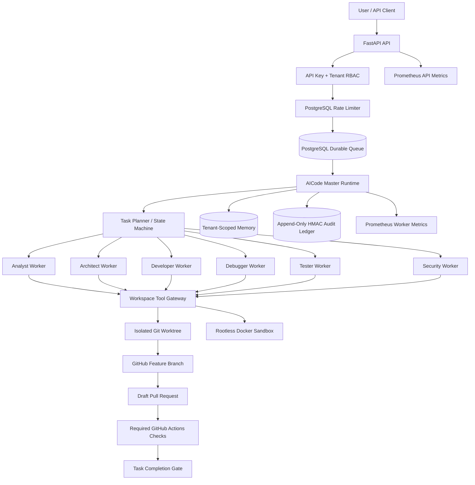

# RUSA-AI AICode Agent — Enterprise Architecture

## 1. Mission and operating model

AICode is the autonomous software-engineering subsystem of RUSA-AI. It accepts a scoped coding task, refreshes an authorized Git mirror, creates an isolated feature worktree, delegates work to specialized agents, executes validation in a disposable sandbox, publishes a draft pull request, and waits for required GitHub Actions checks.

The architecture is hierarchical and autonomous within explicit policy boundaries. It is not an unrestricted shell agent.

### Autonomy boundaries

**Allowed without per-action approval**
- Read files in the tenant-authorized repository.
- Create and edit ordinary application, test, and documentation files in a task worktree.
- Run registered validation profiles in the isolated sandbox.
- Commit and push only to the task's generated feature branch.
- Open a draft pull request.

**Protected or prohibited**
- Merge, deploy, release, production writes, secret changes, repository permission changes, and destructive operations require human approval or are not exposed.
- The agent cannot write dependency manifests, Dockerfiles, Compose files, CI workflows, environment templates, Git attributes, protocol schemas, database migrations, or deployment configuration. Those files require human review.
- No arbitrary shell tool is exposed to model output.
- No agent writes directly to `main`.
- The system never promotes a task to success based on model-authored claims.

## 2. Logical architecture

## 3. Specialized workers

| Worker | Responsibility | Permissions |
|---|---|---|
| Analyst | Repository inventory, relevant code reading, defect localization | List/read/diff |
| Architect | Design and implementation plan | List/read/diff |
| Developer | Implement approved code/test/documentation changes | List/read/write/diff |
| Debugger | Diagnose failures and propose fixes | List/read/check/diff |
| Tester | Execute pytest validation profile | List/read/check/diff |
| Security | Execute Ruff, Bandit, and compile checks | List/read/check/diff |

Workers run sequentially within a task to preserve a predictable handoff. Multiple tasks can run concurrently across worker processes because task claims use PostgreSQL row locking and leases.

## 4. Task and worker contracts

The master owns the task state machine:

`received -> observing -> planning -> executing -> verifying -> succeeded | awaiting_approval | blocked | failed | cancelled`

Only the master may transition task state. Invalid transitions raise an error.

A `CodingTask` carries:
- UUID task identifier
- Tenant identifier in task metadata
- Repository full name, base branch, and generated work branch
- Objective and context
- Explicit acceptance criteria

A `WorkerResult` carries:
- Worker role
- Summary and success flag
- Artifact paths
- Tool-generated evidence
- Blockers

Worker messages are provider-agnostic. The host injects an OpenAI-compatible provider; model output is parsed as a strict JSON action envelope. Unknown tools, unknown action fields, unexpected arguments, malformed JSON, and role escalation are rejected.

Model output is untrusted. It cannot submit test evidence. Only the tool gateway can create `check:pytest`, `check:ruff`, `check:bandit`, and `check:compile` evidence from actual sandbox exit codes.

## 5. Tool gateway and sandbox

The gateway exposes only:
- `list_files`
- `read_file`
- `write_file`
- `git_diff`
- `run_check`

Path handling rejects traversal, absolute paths, symlinks, environment files, credential names, private-key material, and protected configuration surfaces. File writes are atomic and size-bounded.

The validation sandbox:
- Runs in a separate container using a pinned image digest in production.
- Runs as UID/GID 10001.
- Has no network access.
- Uses a read-only container root, dropped Linux capabilities, no-new-privileges, PID/CPU/memory limits, and a bounded temporary filesystem.
- Receives a bounded source snapshot, not the live worktree.
- Does not receive Git metadata, environment files, credentials, or the worker's GitHub token.
- Is terminated on timeout.

The worker host's Docker daemon must be rootless and dedicated to AICode. Never mount a rootful host Docker socket into a general application container.

## 6. Repository lifecycle

1. Validate tenant-to-repository authorization.
2. Refresh only the authorized base branch from the exact HTTPS GitHub origin.
3. Create or reuse the task-specific feature worktree.
4. Execute workers and sandbox checks.
5. Stage only allowed paths; Git hooks and external diff/text conversion are disabled.
6. Commit and push to the generated feature branch using a fine-grained GitHub token.
7. Create or reuse a draft pull request.
8. Wait for the required GitHub Actions check runs:
   - `Test, lint, and security`
   - `Build production image`
9. If checks pass, mark the task succeeded and clean the worktree.
10. If checks are missing, fail, or cannot be verified, move the task to `awaiting_approval`. Do not merge or deploy.

GitHub origin validation requires HTTPS, hostname exactly `github.com`, no embedded credentials, and the exact authorized owner/repository path. Pushes are non-force and limited to the task branch.

## 7. Persistence and isolation

### PostgreSQL
- `aicode_jobs`: durable queue, retry count, lease, and terminal state.
- `aicode_memory`: tenant-scoped task memory.
- `aicode_audit_events`: append-only, HMAC-chained audit records.
- `aicode_rate_limits`: tenant-scoped fixed-window API counters.

All tenant-facing reads and writes include tenant identity. Repository authorization is checked both at API intake and worker execution.

### SQLite and JSONL
SQLite memory and JSONL audit adapters are development/test conveniences. Production worker runtime uses PostgreSQL memory and audit stores.

### Audit integrity
Audit records include timestamp, tenant, actor, event, task, details, previous hash, and HMAC digest. Production database triggers reject UPDATE, DELETE, and TRUNCATE. Runtime database role receives SELECT/INSERT only on the audit table; schema ownership remains with the migration role.

## 8. Model provider

The coding workers use an injected OpenAI-compatible endpoint with JSON-object response mode. The public chat API uses a separate OpenAI-compatible chat adapter.

Required endpoint paths:
- `GET /models` for readiness
- `POST /chat/completions` for chat and agent calls

The coding model must reliably honor JSON-object response format. The model endpoint may be self-hosted or an explicitly approved processor. Repository code and task context are sent to that endpoint; data residency and retention must be reviewed before production use.

## 9. API surface

| Endpoint | Method | Purpose |
|---|---|---|
| `/health` | GET | Liveness |
| `/health/ready` | GET | Inference endpoint reachability |
| `/metrics` | GET | Authenticated Prometheus API metrics |
| `/v1/chat/completions` | POST | OpenAI-compatible non-streaming chat |
| `/v1/validate-task` | POST | A2A task envelope validation |
| `/v1/auth/session` | GET | Resolve tenant identity and roles from an API key |
| `/v1/aicode/tasks` | POST | Tenant-scoped task intake |
| `/v1/aicode/tasks` | GET | Tenant-scoped task history with status filter and pagination |
| `/v1/aicode/tasks/{task_id}` | GET | Tenant-scoped task status |
| `/v1/aicode/tasks/{task_id}` | DELETE | Cancel queued/running/awaiting task |

API authentication maps long random API keys to tenant IDs. Production requires keys of at least 32 UTF-8 bytes, a repository allowlist per tenant, PostgreSQL-backed rate limits, and a configured inference endpoint.

## 10. Quality gates and release governance

A task can be marked successful only when all of the following are true:
- Every required worker completes without blockers.
- The Tester worker produces a real successful pytest exit code.
- The Security worker produces real successful Ruff, Bandit, and compile exit codes.
- A commit is pushed to the task feature branch.
- A draft PR is created or found.
- Both required GitHub Actions jobs complete successfully.

Missing or unverifiable evidence is not treated as success. Human approval is still required to convert a draft PR to a mergeable PR and merge it. Deployment remains a separate operator-controlled process.

## 11. Production acceptance criteria

| Requirement | Implementation evidence | Production gate |
|---|---|---|
| Hierarchical orchestration | Master + six typed workers | Unit/integration tests |
| Bounded autonomy | Role permissions, allowlists, state machine | Adversarial tests |
| Tenant isolation | API keys, repository allowlist, tenant-scoped DB keys | Cross-tenant penetration tests |
| Durable queue | PostgreSQL leases, retries, cancellation | Multi-worker concurrency tests |
| Persistent memory | PostgreSQL tenant-scoped storage | Restart/recovery tests |
| Audit integrity | HMAC chain and immutable DB triggers | Tamper and restore tests |
| Sandbox | Rootless Docker, network disabled, source snapshot | Escape/resource-exhaustion tests |
| Git safety | Exact origin, task branches, protected paths | Malicious remote/path tests |
| CI verification | Required GitHub check runs | Live PR check evidence |
| Rate limiting | PostgreSQL tenant counters | Load and bypass tests |
| Observability | Prometheus API/worker metrics and logs | Dashboard and alert tests |
| Recovery | Persistent volumes and database schema | Backup/restore drill |

## 12. Certification statement

The repository contains the implementation and deployment candidate. It is not certified for production merely because code has been committed. Certification requires successful CI on the final PR head, deployment-specific secrets and infrastructure, tenant-isolation and sandbox adversarial testing, backup/restore evidence, load testing, and an operator-reviewed release.
