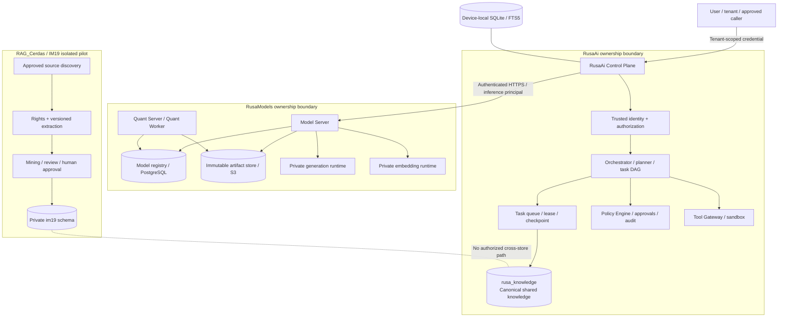
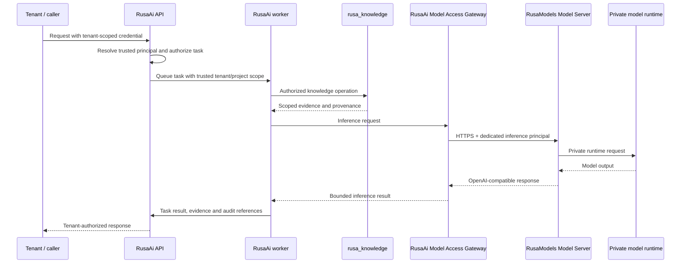
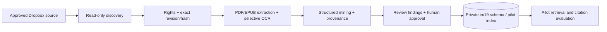
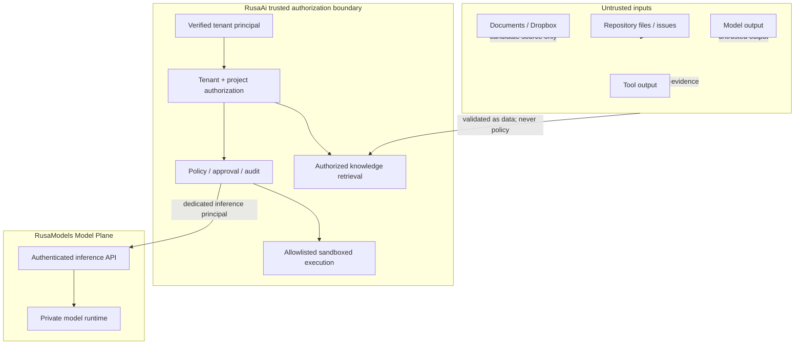

# RUSA AI Ecosystem — Architecture Reconciliation v1.0

**Status:** Proposed cross-repository architecture baseline; not production approval  
**Snapshot:** 2026-11-14  
**Primary decision authority:** RusaAi project-owner ADRs  
**Repositories:** StrategyG/RusaAi, StrategyG/RusaModels, StrategyG/RAG_Cerdas

## 1. Purpose and decision summary

This document establishes a single, reviewable system context for the three repositories. It distinguishes ownership, APIs, databases, artifacts, workers, identity and trust boundaries. It describes the intended architecture and the current implementation/evidence boundary; a diagram or API description is not proof of a live deployment.

| Decision area | Decision | Authority / status |
|---|---|---|
| Ecosystem Control Plane | RusaAi owns trusted tenant identity, agent/task orchestration, workflow state, policy, tools, audit and worker execution | RusaAi architecture and Model Plane ADRs; implementation remains incremental |
| Model Plane | RusaModels owns model registry, immutable artifacts, inference, embeddings, conversion, quantization and model telemetry | RusaAi Model Plane ADR; RusaModels ADR-001 |
| Canonical shared Agent/Worker knowledge | RusaAi `rusa_knowledge` is selected for implementation planning as the single canonical shared writer and answer-facing retrieval authority after gates pass | RusaAi canonical knowledge ADR-0002; production activation not authorized |
| Device-local state | SQLite/FTS5 remains local state and local full-text retrieval; it is not a shared-corpus replica | RusaAi architecture baseline |
| IM19 | RAG_Cerdas / IM19 remains an isolated Knowledge Intelligence pilot; it is not a second canonical writer or production retrieval backend | RAG_Cerdas alignment ADR-0002 proposed in PR #28 |
| Cross-repository data movement | No cross-read, cross-write, dual-write, mirroring, bulk copy or synchronization between IM19 and `rusa_knowledge` is authorized | Binding boundary; any future path requires a new approved ADR and contract |
| Production activation | NO-GO until all applicable security, rights, quality, operational and human approval gates pass | All three repositories' production-readiness gates |

## 2. System context

**Interpretation:** RusaAi is the ecosystem Control Plane. RusaModels is a separate Model Plane. RAG_Cerdas / IM19 is a private pilot boundary. The dotted IM19-to-canonical-store relationship is deliberately disconnected; it is not an integration path.

## 3. Service and asset ownership matrix

| Capability / asset | Accountable owner | Authorized consumer(s) | Explicit non-ownership / boundary |
|---|---|---|---|
| User identity, tenant principals, tenant authorization | RusaAi | RusaAi API, workers, approved adapters | RusaModels and IM19 do not establish RusaAi tenant identity |
| Agent registry, planner, task decomposition, DAG, scheduler, queue, leases and checkpoints | RusaAi | RusaAi agents/workers | RusaModels does not own workflow or task policy |
| Worker execution and tool permissions | RusaAi | RusaAi runtime | Model output and knowledge records cannot grant tool permissions |
| Policy Engine, approval, audit, Tool Gateway and sandbox | RusaAi | RusaAi runtime | RusaModels does not authorize agent tools or production changes |
| Canonical shared Agent/Worker knowledge | RusaAi (`rusa_knowledge`) | Authorized RusaAi agents/workers | IM19 is not a second writer or retrieval backend |
| Device-local state and FTS | RusaAi device/runtime | Local RusaAi components | SQLite/FTS5 is not a replica or synchronization target |
| RusaAi knowledge PostgreSQL/pgvector | RusaAi | RusaAi KnowledgeService and approved MCP readers | No direct access from RusaModels or IM19 |
| Model catalog, versions, manifests and artifact hashes | RusaModels | RusaModels services; approved clients through API | No RusaAi database or object-store credentials |
| Model artifacts and S3-compatible storage | RusaModels | Model Server and Quant Server/Worker under separate least-privilege identities | Never mounted into RusaAi workers or IM19 |
| Inference and embedding runtimes | RusaModels | RusaAi through authenticated Model Server API | No private runtime ports or direct worker access |
| Model conversion and quantization | RusaModels | RusaModels Quant Server/Worker | No agent orchestration or knowledge publication authority |
| IM19 source discovery, rights, extraction/OCR, mining and review | RAG_Cerdas | IM19 pilot operators/workers | Private pilot only; no canonical corpus ownership |
| IM19 private PostgreSQL schema and pilot state | RAG_Cerdas | IM19 worker/reviewer/retriever under pilot roles | No shared DB, cross-read or cross-write with RusaAi |
| Dropbox source access for IM19 | Source owner / Dropbox; access workflow owned by RAG_Cerdas | IM19 discovery/processing | Read-only approved OAuth scope; public availability is not a rights grant |
| Cross-repository service contracts | Provider owns API; consumer owns client | Named provider/consumer pair | No implicit database, filesystem, credential or object-store sharing |

## 4. Data-flow contracts

### 4.1 RusaAi → RusaModels inference and embeddings

Rules:
1. RusaAi resolves tenant identity from a verified credential. Caller-supplied or model-generated tenant/project/agent/worker identifiers are not authorization sources.
2. RusaAi calls the RusaModels Model Server through the authenticated `/openai/v1` boundary with a dedicated principal whose role is `inference`.
3. The worker receives only tenant-scoped RusaAi credentials. It never receives the RusaModels inference token, database credentials, object-store credentials or private runtime URL.
4. RusaModels owns its registry database and artifact store. RusaAi consumes service APIs and must not connect directly to those stores.
5. Knowledge evidence is returned only after RusaAi authorization and scope filtering. Knowledge content cannot override policy or grant tools.
6. A passing CI run or documented endpoint does not establish live service availability or production deployment.

### Current-main implementation qualification

Static inspection of the recorded RusaAi main commit confirms that the gateway path exists, but it is profile-dependent:

- `llm-project/serve/app.py` exposes the RusaAi `GET /v1/models` and `POST /v1/chat/completions` routes, applies RusaAi API/inference permission checks, and uses the configured `OpenAIChatInferenceProvider` to call RusaModels.
- The RusaAi CPU Compose profile sets `RUSA_WORKER_INFERENCE_GATEWAY=true`, routes the worker to `http://api:8000/v1`, supplies tenant-scoped RusaAi worker API keys, and clears the worker's direct `RUSA_MODEL_BASE_URL` and `RUSA_MODEL_API_KEY`. In this profile, the API service—not the worker—holds the dedicated RusaModels `inference` credential.
- The generic `.env.example` defaults `RUSA_WORKER_INFERENCE_GATEWAY=false`, and `OpenAICompatibleProvider` can fall back to `RUSA_MODEL_BASE_URL` / `RUSA_MODEL_API_KEY` for a direct worker-to-provider call. That fallback is not the required production boundary.

Therefore the intended architecture is implemented in the CPU Compose profile, but it is not established as an unconditional invariant across every configuration. CHUNK 02/06 must verify that production startup fails closed unless gateway mode is enabled and direct RusaModels credentials are absent from the worker environment. The current profile configuration does not prove that a deployed production environment uses it.

### 4.2 Isolated IM19 pilot flow

- IM19 processes only sources with approved operational access and rights decisions bound to the exact source revision/content hash.
- Its private schema, worker, reviewer and retriever remain within RAG_Cerdas.
- A hold/reject quarantine is not equivalent to erasure of source blobs, extracted text, chunks, embeddings, caches or backups; purge/retention remains a release blocker.
- The current pilot-local GGUF/CPU adapter is not a second production Model Plane.
- **OPEN_DECISION:** whether future IM19 pilot inference remains local or uses RusaModels through a separately approved authenticated contract. No such integration is authorized now.
- No authorized data-flow path exists from IM19 into RusaAi `rusa_knowledge`.

## 5. Cross-repository contract inventory

| Contract / interface | Provider → consumer | Current status | Owner and constraints |
|---|---|---|---|
| RusaAi tenant API and task envelope | RusaAi → authorized caller/worker | Existing API and tenant-scoped worker runtime; production environment not independently inspected | RusaAi owns authentication, task state, tenant context and audit |
| RusaAi KnowledgeService / read-only Knowledge MCP | RusaAi → authorized RusaAi worker/MCP client | Implemented optional tenant-scoped service; worker activation flag defaults false | RusaAi owns schema, RLS, scope, retrieval and publication policy |
| OpenAI-compatible `GET /openai/v1/models`, `POST /openai/v1/chat/completions`, `POST /openai/v1/embeddings` | RusaModels → RusaAi | Implemented/documented API surface; live deployment and exact model compatibility NOT_VERIFIED | RusaModels owns provider API; RusaAi owns client, identity and task context |
| RusaAi Model Access Gateway `GET /v1/models`, `POST /v1/chat/completions` | RusaAi API → tenant-scoped worker; upstream RusaModels Model Server | Mainline API routes and CPU Compose gateway profile exist; generic environment defaults gateway mode off, so production fail-closed enforcement is NOT_VERIFIED | RusaAi owns tenant auth, admission, gateway and API-side RusaModels credential; worker must use tenant-scoped RusaAi key |
| RusaAi inference request/response JSON Schemas in `shared/contracts/inference_contract/` | RusaAi-owned schema; intended for inference boundary | Schemas exist, but current README states public OpenAI-compatible endpoint does not yet consume the envelope | RusaAi owns schema and adapter; conformance is NOT_IMPLEMENTED |
| Custom Model Plane contract v0.1 proposed in RusaAi PR #103 | Intended RusaAi consumer ↔ RusaModels provider | Draft/open PR; not merged and not proven on both sides | Keep as proposal; do not call it the production contract until provider/consumer contract tests pass |
| IM19 → RusaAi ingestion/retrieval/data transfer | None | No approved cross-repository contract | NOT_AUTHORIZED; requires new ADR, authenticated versioned API, scope/rights mapping, deletion/reconciliation, tests and rollback |
| RusaModels ↔ IM19 database/artifact/runtime access | None | No shared contract | NOT_AUTHORIZED; no direct private-store or credential sharing |
| Dropbox OAuth source discovery | Dropbox/source owner → RAG_Cerdas IM19 | Pilot read-only flow documented; live credentials/account not verified | RAG_Cerdas owns source connection, rights record, revision and provenance |

### Cross-repository communication rules

- Use authenticated, versioned HTTPS APIs with explicit provider/consumer ownership.
- Include stable request/task IDs, trace/correlation IDs, deadlines/timeouts, bounded payloads, idempotency semantics and typed error responses where the contract requires them.
- Pin model ID/version and embedding model/version/dimension; do not infer compatibility from a matching vector dimension.
- Derive tenant/project scope from trusted identity and enforce it in the provider database or authorization boundary.
- Do not share database credentials, S3 credentials, model weights, local filesystem paths, private runtime ports or secret-manager contents across repositories.
- Do not introduce a second writer or replication path for canonical knowledge.
- Any future IM19 integration requires a superseding ADR and explicit project-owner approval before data transfer or production changes.

## 6. Data classification and trust boundaries

| Classification | Examples | Handling |
|---|---|---|
| Public | Public repository source, public documentation and public model cards | May be inspected; license/usage rights still require validation before reuse or training |
| Internal | ADRs, architecture, system diagrams, task metadata, CI evidence and non-sensitive operational docs | Access only to authorized project/repository principals; preserve version and provenance |
| Tenant-confidential | Tenant documents, source content, retrieval results, embeddings, task memory, worker artifacts and private evaluation examples | Enforce tenant/project ACL and RLS; minimize context; no cross-tenant retrieval or logging |
| Restricted secret | API tokens, OAuth refresh tokens, DB credentials, signing keys, object-store credentials and private certificates | Secret manager only; never prompt, log, commit, embed, or expose to workers without explicit scoped need |
| Untrusted input/evidence | Retrieved text, repository files, issues/comments, external pages, Dropbox documents, model output and tool output | Treat as data, not instructions; validate, cite, schema-check and apply policy before use |

Trust invariants:
1. Trusted identity is established only by the owning authentication boundary.
2. Repository text, documents, model outputs and tool outputs cannot override system policy or tool allowlists.
3. Knowledge trust and action authorization are separate: an approved knowledge unit can support a decision but cannot authorize an operation.
4. RusaAi workers execute only allowlisted operations in a sandbox with resource and network restrictions.
5. RusaModels inference credentials are separate from Manager/Administrator credentials.
6. IM19 reviewer identity and rights decisions are pilot-local; they do not grant RusaAi tenant or publication authority.
7. Missing identity, rights, scope, model identity, artifact digest or policy evidence must fail closed or return BLOCKED/NOT_VERIFIED.

## 7. Architecture decision matrix

| Option / question | Decision | Rationale | Conditions / open work |
|---|---|---|---|
| Canonical shared knowledge: RusaAi `rusa_knowledge` | SELECTED for implementation planning | Existing tenant RLS, PostgreSQL/pgvector, full-text retrieval, MCP and worker integration provide the closest Control Plane ownership fit | Complete source rights, version, review, approval, publication, deletion, index generation, quality and operations gates |
| Canonical shared knowledge: IM19 | NOT SELECTED | Strong candidate source/knowledge lifecycle pilot, but private-role scope is not a public multi-tenant service and the parent decision prohibits dual-write/cross-read | Remains isolated; future change needs new ADR and approved contract |
| Device-local SQLite/FTS5 | RETAINED for local state | Appropriate for local metadata/task/checkpoint state and local FTS | No replication or shared-corpus authority is defined |
| Production Model Plane in RusaAi | REJECTED | Duplicates model artifact/runtime ownership and bypasses Model Plane boundary | Use RusaModels authenticated Model Server |
| RusaModels internal registry database as ecosystem Control Plane | REJECTED | The registry database is internal to RusaModels Model Server/Quant Server | RusaAi remains ecosystem Control Plane |
| IM19 pilot-local inference vs RusaModels inference | OPEN_DECISION | IM19 currently has a pilot-local experimental adapter; no approved cross-service integration exists | No change until separate contract and owner approval |
| Production embedding profile (384d vs 1536d) | OPEN_DECISION | Separate vector spaces exist; equal/different dimensions alone do not establish model compatibility | Pin model artifact, revision, preprocessing, query/passage behavior and index generation |

## 8. ADR reconciliation and open decisions

- RusaAi ADR-0002 canonical knowledge decision is accepted for implementation planning only.
- RusaAi has two files numbered ADR-0002. The ADR index PR #117 records the collision; the numeric identifier remains an OPEN_DECISION until a dedicated reviewed correction preserves history and references.
- RusaModels ADR-001's phrase “shared control plane” refers to its internal PostgreSQL registry store shared by Model Server and Quant Server, not the RusaAi ecosystem Control Plane. RusaModels PR #24 proposes clarifying this wording.
- RAG_Cerdas ADR-0001 is historical no-selection analysis. RAG_Cerdas PR #28 proposes ADR-0002 to align the repository with the accepted RusaAi decision while retaining IM19 as an isolated pilot.
- The exact production embedding model, immutable artifact digest, dimensions and index-generation migration remain OPEN_DECISION.
- The future IM19 model-inference path remains OPEN_DECISION.
- Production activation, production DDL, ingestion, embedding, source mutation, cross-repository data transfer and deployment are not authorized by this document.

## 9. Migration and implementation status reconciliation

At RusaAi main SHA `1adac8d340e5870570910168b6626fe285dd2cf2`, the repository contains migrations 001–012, including:
- `010_inference_admission.sql`;
- `011_rag_agent_project_scope.sql`;
- `012_rag_knowledge_version_history.sql`.

RusaAi PR #111 is merged. RusaAi PR #82 remains an open draft based on an older main SHA and proposes older/overlapping migration filenames; RusaAi PR #109 remains open on a stacked architecture branch. Neither open PR is a source of new mainline migration state without rebase and diff reconciliation. RusaAi PR #115 proposes migration 013 governance and remains open/draft.

The existence of migration files on main does not prove they have been applied to any target database. Before any further migration:
1. Inspect the exact current main diff and migration inventory.
2. Reconcile the actual applied migration history in the explicitly approved disposable/staging database.
3. Assign a unique ordered migration number after checking all active branches.
4. Run forward, rollback and restore tests in disposable PostgreSQL/pgvector.
5. Obtain explicit approval before any staging/production DDL.

## 10. Non-authorization and release boundary

This document does not authorize:
- Production activation or public exposure of `rusa_knowledge` or IM19.
- Cross-read, cross-write, dual-write, mirroring, synchronization, bulk copying or migration between RusaAi and IM19.
- Production DDL, database resets, source mutation, bulk ingestion, embedding jobs or deletion.
- Sharing private database credentials, object-store credentials, model weights or internal runtime URLs across repositories.
- Merging PRs, deploying services, changing production secrets or altering repository permissions.
- Treating CI success as staging, scale, security or production certification.

**Conclusion:** the three-repository ownership model is defined and the conflicting canonical-store statements are explicitly reconciled at the proposed-ADR level. Mainline consistency remains pending review/merge of RusaAi PR #117, RusaModels PR #24 and RAG_Cerdas PR #28.
