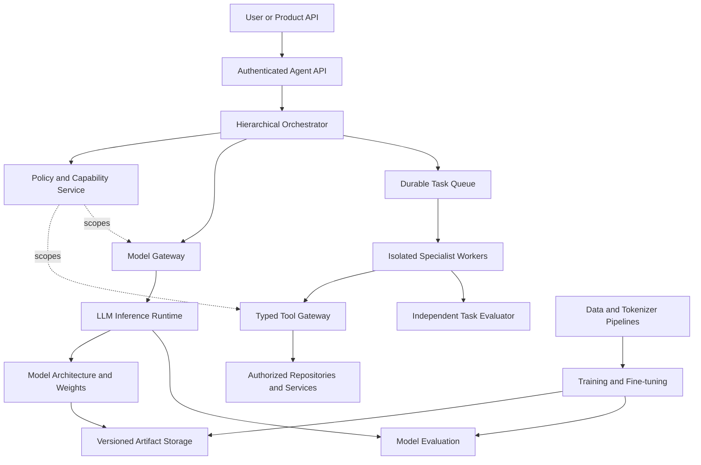

# RUSA-AI LLM Platform Architecture

- **Document ID:** RUSA-LLM-ARCH-001
- **Version:** 1.0.0
- **Status:** Proposed architecture; implementation and production readiness are not verified
- **Repository baseline:** `main` at `fc27f227f7ab5d43135f9bb2d074c208bfbb956d`
- **Owner:** RUSA-AI engineering

## 1. Purpose

Define a maintainable engineering platform for developing, adapting, evaluating, and serving an internal RUSA-AI language model. The platform supports two distinct paths:

1. **Model adaptation:** load a licensed, compatible pretrained checkpoint and perform evaluation, supervised fine-tuning, or parameter-efficient fine-tuning.
2. **Foundation-model research:** prepare reproducible data, tokenizer, architecture, distributed training, and evaluation pipelines for a future pretraining program.

These paths share interfaces and evaluation contracts, but they do not share the same compute assumptions. A working fine-tuning pipeline is not evidence that the proposed foundation model can be pretrained.

The label `opus-5.5-blueprint` is an illustrative internal configuration name supplied for planning. It is not an official model identifier, a claim about another provider's architecture, or evidence that weights exist.

## 2. Architecture principles

1. **Explicit boundaries:** model implementation, training, inference, and agent orchestration are separate subsystems.
2. **Contracts before scale:** configuration, dataset manifests, tokenizer metadata, checkpoint metadata, tool schemas, and evaluation results are versioned.
3. **Reproducibility:** each run records source revision, config hash, dataset and tokenizer versions, seed, dependency lock, hardware, and checkpoint lineage.
4. **Fail closed:** invalid configuration, missing model artifacts, invalid credentials, or unavailable policy services must not produce a successful inference or task-completion claim.
5. **Evidence-based readiness:** a planned config, passing unit test, or successful container build is not proof of model quality, capacity, or production readiness.
6. **Local-first runtime:** local inference is the default development path. External model providers require explicit configuration and policy approval.
7. **Least privilege:** model output cannot grant itself repository, filesystem, shell, network, secret, or deployment permissions.
8. **Artifact separation:** datasets, checkpoints, optimizer states, and run outputs live in controlled artifact storage, not Git.

## 3. System boundaries

The LLM platform is a model capability provider. The RUSA-AI agent platform is a separate control plane that plans work, grants scoped capabilities, invokes tools, and verifies outcomes.



### 3.1 LLM platform responsibilities

- Dataset ingestion, cleaning, filtering, deduplication, provenance, and manifests.
- Tokenizer training, versioning, encoding, decoding, and compatibility checks.
- Model architecture and reusable neural-network components.
- Pretraining and post-training orchestration, distributed execution, checkpointing, and resume.
- Model capability, quality, safety, robustness, and performance evaluation.
- Model loading, inference, batching, caching, streaming, quantization, and health checks.
- Model registry metadata and immutable artifact references.

### 3.2 Agent platform responsibilities

- User/task identity, tenant boundaries, authorization, budgets, and lifecycle.
- Hierarchical planning, dependency graphs, scheduling, worker leases, retries, and cancellation.
- Typed tool adapters, isolated execution, approval gates, and audit.
- Independent verification of repository changes and task acceptance evidence.

The agent platform calls the LLM through a typed model gateway. The LLM does not directly own the tool gateway or its credentials.

## 4. Repository layout target

The current repository contains an initial `llm-project/` scaffold. Preserve it during migration and move executable Python packages toward a conventional `src/` layout. Do not rename or delete existing paths until imports, Docker commands, CI, and downstream consumers have been migrated and tested.

```text
RusaAi/
├── src/
│   └── rusa_llm/
│       ├── data/                 # Dataset pipeline interfaces and transforms
│       ├── tokenization/         # Tokenizer adapters and metadata
│       ├── models/
│       │   ├── architectures/
│       │   ├── attention/
│       │   ├── moe/
│       │   ├── embeddings/
│       │   ├── vision/
│       │   └── interfaces.py
│       ├── training/
│       │   ├── pretraining/
│       │   ├── fine_tuning/
│       │   ├── distributed/
│       │   └── checkpointing/
│       ├── evaluation/
│       ├── inference/
│       ├── registry/
│       └── observability/
├── llm-project/
│   ├── configs/
│   │   ├── profiles/
│   │   ├── model.yaml
│   │   ├── training.yaml
│   │   └── inference.yaml
│   └── artifacts/                # Local mount only; excluded from Git
├── rusa_agents/                  # Existing agent control plane
├── schemas/
│   ├── a2a/
│   └── llm/
├── evaluations/
│   ├── datasets/
│   ├── rubrics/
│   └── reports/
├── scripts/
├── tests/
│   ├── unit/
│   ├── integration/
│   ├── contract/
│   ├── regression/
│   ├── performance/
│   └── security/
├── docs/
│   ├── architecture/
│   ├── adr/
│   └── operations/
└── deployment/
```

### Migration rules

- `src/rusa_llm` is the target importable Python package; `llm-project` remains a workspace/configuration area during migration.
- Keep agent implementation under `rusa_agents`; do not duplicate queue, policy, audit, or worker code under `rusa_llm`.
- Keep JSON Schemas under `schemas/llm` and validate them in CI.
- Store large data and model artifacts outside Git. Record immutable URI, checksum, size, license, and owner in manifests.
- Do not add secrets, raw private datasets, checkpoints, optimizer states, or personal data to the repository.

## 5. Model architecture contract

The current blueprint proposes a decoder-only Transformer with:

| Component | Proposed value | Engineering note |
|---|---:|---|
| Transformer layers | 96 | Research target; not implemented evidence |
| Hidden size | 12,288 | Must be divisible by attention heads |
| Query attention heads | 96 | Head dimension = 128 |
| KV heads | 8 | GQA ratio = 12 query heads per KV head |
| Positional encoding | RoPE | Long-context scaling method remains an experiment |
| Normalization | RMSNorm | Must be covered by numerical tests |
| Activation | SwiGLU | Intermediate dimension is not yet specified in the source config |
| MoE experts | 64 | Proposed expert count |
| Experts per token | 2 | Top-2 routing target |
| Context window | 1,000,000 | Research target; not a serving guarantee |
| Modalities | Text and image | Image path requires a defined vision encoder/projector and data contract |

### 5.1 Required implementation decisions

Before model implementation is accepted, specify and test:

- Attention implementation and mask semantics.
- Query/key/value projection shapes and tensor-parallel partitioning.
- RoPE base, scaling method, interpolation or extrapolation strategy, and maximum tested length.
- RMSNorm epsilon and numerical precision.
- SwiGLU intermediate dimension and initialization.
- MoE router logits, top-k selection, expert capacity, overflow behavior, auxiliary load-balancing loss, and router stability.
- Expert parallelism and interaction with tensor, pipeline, and data parallelism.
- Weight tying, vocabulary size, special-token IDs, and checkpoint format.
- Vision encoder, projection/resampler, image token budget, and multimodal alignment objective before image support is declared implemented.

### 5.2 Capacity estimate — illustrative only

A rough parameter and memory estimate requires an intermediate dimension, which is absent from the current model configuration. For planning only, assume a SwiGLU expert intermediate dimension of 32,768 and three expert projections (gate, up, down).

Under that assumption:

- Expert parameters are approximately (3 	imes 12{,}288 	imes 32{,}768 	imes 64 	imes 96), or about 7.42 trillion.
- Attention projections add approximately 31.4 billion parameters under the stated GQA dimensions.
- The resulting estimate is approximately 7.45 trillion parameters before embeddings, output head, routers, normalization, vision components, and other implementation details.
- BF16 weight storage alone is roughly 14.9 TB decimal (about 13.5 TiB), excluding optimizer state, gradients, activations, communication buffers, and replication.
- A batch-one KV-cache estimate for 1,000,000 tokens, 96 layers, 8 KV heads, head dimension 128, K/V tensors, and BF16 storage is about 366 GiB before allocator and runtime overhead.

These figures are sizing illustrations, not measured model statistics. The assumed intermediate dimension is not silently added to the approved model config. A hardware and parallelism study is required before committing to a full-pretraining budget.

### 5.3 Long-context gate

RoPE alone does not establish one-million-token capability. Long-context support requires:

1. An explicit attention strategy and memory plan.
2. A documented RoPE scaling method and training/inference compatibility.
3. Chunked prefill and bounded KV-cache management.
4. Tests for positional generalization, retrieval across long distances, needle/multi-needle tasks, long-document reasoning, and degradation by position.
5. Throughput, latency, and peak-memory benchmarks at increasing sequence lengths.
6. A serving admission policy that rejects requests exceeding verified limits.

Until these gates pass, one million tokens remains a target in configuration, not an advertised product capability.

## 6. Data engineering

Every dataset release must have a manifest containing:

- Dataset ID, version, source URI, source owner, acquisition timestamp, and license/terms.
- Content checksum, record count, byte size, language distribution, and modality.
- Transformation code revision and configuration hash.
- Deduplication method and duplicate-rate report.
- Quality, toxicity, privacy/PII, contamination, and safety-filter reports.
- Train/validation/test split identifiers and leakage controls.
- Retention, deletion, and access-control requirements.

Pipeline stages:

`ingestion → quarantine → parsing → normalization → filtering → deduplication → quality review → split → manifest → immutable storage`

Quarantine malformed or unlicensed records. Never infer permission to train from public accessibility alone. Dataset snapshots must be immutable once a training run starts.

## 7. Tokenizer engineering

- Version tokenizer artifacts independently from model checkpoints.
- Record tokenizer implementation, vocabulary size, merges/model checksum, normalizer, pre-tokenizer, special-token mapping, and training corpus manifest.
- Test encode/decode round trips, Unicode, Indonesian and multilingual text, code, whitespace, control tokens, and malformed input.
- Reject checkpoints whose tokenizer identity or special-token mapping is incompatible.
- Measure compression and fertility by language and domain; do not optimize only for English.

## 8. Training lifecycle

1. **Pretraining:** next-token prediction over approved immutable dataset snapshots.
2. **SFT:** supervised instruction data with provenance and quality review.
3. **Preference optimization:** choose and document an objective such as DPO or a separately justified RLHF/RLAIF pipeline.
4. **Reasoning training:** use only reviewed data and task-specific evaluation; do not treat chain-of-thought disclosure as a default requirement.
5. **Safety alignment:** policy data, refusal calibration, adversarial testing, and regression evaluation.

Each run must record:

- Git commit, config hash, dependency lock hash, Python/CUDA/PyTorch versions.
- Model initialization/checkpoint and tokenizer checksums.
- Dataset manifest IDs and hashes.
- Hardware topology, world size, parallelism plan, precision, and seed.
- Optimizer, scheduler, batch and sequence lengths, gradient accumulation, clipping, and loss settings.
- Checkpoint cadence, retention, resume test, and failure recovery.
- Training curves, throughput, utilization, memory, and numerical anomaly logs.

Checkpoint publication is atomic: write to a temporary location, verify metadata and checksums, then publish the immutable manifest.

## 9. Evaluation contract

Evaluation is a release gate, not an afterthought.

| Dimension | Required evidence |
|---|---|
| Language quality | Versioned Indonesian and multilingual task sets |
| Instruction following | Held-out instruction and format compliance tests |
| Reasoning | Task-specific, contamination-reviewed benchmarks |
| Coding | Unit-test-backed coding tasks and repository repair tests |
| Long context | Position-stratified retrieval and reasoning tests |
| Multimodal | Image understanding set only after vision path exists |
| Safety | Refusal, jailbreak, prompt-injection, privacy, and misuse tests |
| Robustness | Malformed inputs, Unicode, truncation, adversarial and noisy inputs |
| Performance | Prefill/decode latency, tokens/sec, concurrency, memory, and cost |
| Regression | Compare every candidate to a pinned baseline |

Record dataset version, scoring code version, model/checkpoint checksum, environment, raw scores, confidence intervals where appropriate, and known limitations. Never report a benchmark score without identifying its exact model artifact and evaluation set.

## 10. Inference and model gateway

The inference runtime owns model loading and token generation. It does not own user authorization or tool permissions.

Required interfaces:

- Model loader with explicit artifact URI, checksum, tokenizer compatibility, and device map.
- Typed generation request/response with bounded prompt length, output tokens, sampling parameters, and cancellation.
- Health and readiness endpoints; readiness is false if weights or required dependencies are unavailable.
- Streaming with backpressure and disconnect cancellation.
- Dynamic batching and bounded admission queue.
- KV-cache policy, memory accounting, and request limits.
- Quantization adapter with quality regression evidence for each supported format.
- Speculative decoding only when a compatible draft model exists and equivalence/quality behavior is measured.
- Structured tool-call output as data only; the separate agent policy service decides whether a tool call is authorized.

No mock response may be represented as real model inference. If no model artifact is loaded, inference returns an explicit unavailable/not-ready response.

## 11. Security, privacy, and operations

- Authentication and tenant authorization are enforced at API/control-plane boundaries.
- Secrets are injected by the deployment platform; never stored in YAML, logs, prompts, or artifacts.
- Model inputs and outputs are treated as untrusted data.
- Tool calls are validated against server-owned schemas and capability grants.
- No unrestricted shell, arbitrary network, repository write, secret access, merge, or deployment permission is exposed to model output.
- Dataset and artifact access is tenant/project scoped with audit and retention policy.
- Logs redact credentials and sensitive payloads; retain trace IDs and safe metadata.
- Publish immutable container and model artifact digests.
- Define SLOs, alerts, incident runbooks, backup/restore, rollback, and capacity limits before production deployment.

## 12. Delivery phases

| Phase | Scope | Exit evidence |
|---|---|---|
| 0 | Architecture and contracts | Reviewed ADRs, valid schemas, config tests |
| 1 | Local foundation | Importable package, CPU smoke tests, deterministic config loading |
| 2 | Data and tokenizer | Licensed manifest pipeline, tokenizer round-trip and language reports |
| 3 | Model components | Shape, numerical, gradient, and checkpoint round-trip tests |
| 4 | Adaptation | Fine-tune a compatible pretrained checkpoint; resume and eval evidence |
| 5 | Inference | Real artifact loading, API tests, memory/latency benchmark |
| 6 | Distributed research | Multi-GPU fault/recovery tests and costed training plan |
| 7 | Production certification | Security, load/soak, recovery, SLO, operations, and owner sign-off |

Do not skip phases based on directory presence or architecture documentation.

## 13. Acceptance criteria for this architecture change

- [ ] Model and agent responsibilities are separated.
- [ ] The repository migration path preserves existing paths until consumers are migrated.
- [ ] Model and runtime profile schemas are versioned.
- [ ] Current model config validates against its schema.
- [ ] Local, single-GPU, and multi-GPU profiles are explicitly marked proposed.
- [ ] Geometry and MoE semantic checks are covered by automated tests.
- [ ] One-million-token support is documented as unverified until benchmarked.
- [ ] Parameter/memory estimates state all assumptions.
- [ ] Data provenance, tokenizer compatibility, checkpoint metadata, and evaluation evidence are specified.
- [ ] No claim of trained weights, model quality, or production readiness is made.

## 14. Open decisions

The following require measured evidence or an explicit owner decision:

- Vocabulary size and tokenizer algorithm.
- SwiGLU intermediate dimension and parameter budget.
- Dense, sliding-window, or hybrid long-context attention strategy.
- MoE capacity factor, balancing losses, and expert parallelism topology.
- Vision encoder and image token budget.
- Preferred training framework and distributed topology.
- Supported checkpoint format and model registry.
- Actual GPU type/count, storage throughput, budget, and training schedule.
- Benchmark suites and release thresholds.

**Current conclusion:** this document defines the proposed engineering target. It does not claim that the model architecture, training system, inference runtime, or production deployment is implemented or verified.
