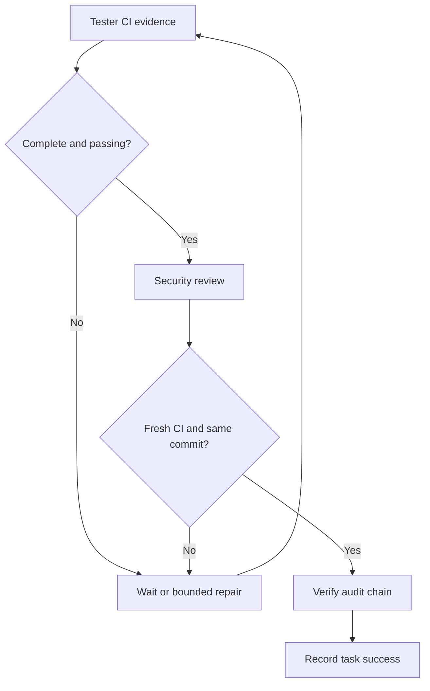

# RUSA-AI Enterprise Hierarchical Agent Architecture

**Architecture decision:** hierarchical multi-agent, full autonomy inside an explicit allowlist, enterprise deployment profile.

## 1. System boundary and operating model

RUSA-AI is split into two independently scalable planes:

- **Inference plane:** the existing FastAPI/Transformers service serves model completions.
- **Agent control plane:** task API, PostgreSQL queue, master orchestrator, specialist workers, GitHub tool gateway, memory, and audit.

The agent control plane calls an OpenAI-compatible model endpoint. Model output is always parsed as a typed proposal. It is never executed as source code or shell input.

Full autonomy means the system can inspect a repository, create a work branch, modify allowlisted files, open a draft pull request, observe CI, and perform bounded repair cycles without a human approving each routine step. It does **not** mean unrestricted host access. Merge, deployment, release, credential access, permission changes, workflow changes, and destructive operations are not exposed as agent tools. Those operations remain under GitHub branch protection and human release approval.

## 2. Logical architecture

~~~mermaid
flowchart TB
    Client[Developer / API Client] --> API[Agent Task API]
    API --> Q[(PostgreSQL Durable Queue)]
    Q --> W[Queue Worker Pool]
    W --> M[Master Orchestrator]
    M --> P[Policy Engine]
    M --> R[Hierarchical Router]
    R --> A[Analyst]
    R --> AR[Architect]
    R --> D[Developer]
    R --> DB[Debugger]
    R --> T[Tester]
    R --> S[Security]
    A --> M
    AR --> M
    D --> M
    DB --> M
    T --> M
    S --> M
    M --> G[GitHub Tool Gateway]
    G --> GH[GitHub Repository / Draft PR / CI]
    M <--> MEM[(Tenant-scoped PostgreSQL Memory)]
    M --> AUD[HMAC Audit Log]
    M <--> LLM[OpenAI-compatible Model Provider]
    GH -->|Checks and CI evidence| T
    T -->|Pass / Fail / Pending| M
    M -->|Checkpoint / retry / lease| Q
~~~

### Runtime sequence

~~~mermaid
sequenceDiagram
    participant C as Client
    participant API as Task API
    participant Q as PostgreSQL Queue
    participant M as Master
    participant W as Specialist Worker
    participant G as GitHub Gateway
    participant CI as GitHub Actions
    participant MEM as Tenant Memory
    C->>API: POST task + tenant + idempotency key
    API->>Q: Enqueue task
    Q-->>API: task_id
    API-->>C: 202 Accepted
    M->>Q: Claim with lease / SKIP LOCKED
    M->>MEM: Retrieve tenant-scoped context
    loop Analyst -> Architect -> Developer
        M->>W: Typed task + bounded prior results
        W-->>M: Validated JSON proposal
        M->>M: Role authorization + risk policy
        M->>G: Allowlisted tool call
        G-->>M: Result + evidence
    end
    M->>G: Create or reuse draft pull request
    G->>CI: Branch push triggers CI
    loop CI pending or bounded repair
        M->>G: Read check-runs
        G-->>M: Pending / failed / passed
        opt Failed and repair budget remains
            M->>W: Debugger diagnosis
            W-->>M: Proposed repair
            M->>G: Write allowlisted file on work branch
        end
    end
    M->>W: Security review
    W-->>M: Risk assessment + blockers
    M->>Q: Persist terminal state / checkpoint
    M->>MEM: Store outcome summary
    M->>M: Append signed audit event
~~~

## 3. Agent hierarchy and responsibilities

| Agent | Responsibility | Allowed tools |
|---|---|---|
| Master Orchestrator | Task lifecycle, stage routing, policy enforcement, checkpoints, retries, final decision | Queue, policy, audit, memory, provider |
| Analyst | Inspect repository, identify current state, dependencies, constraints, acceptance coverage | read_file, list_files |
| Architect | Propose minimal design, affected files, interfaces, migration and test plan | read_file, list_files |
| Developer | Create isolated branch, implement changes, open/reuse draft PR | create_branch, read_file, list_files, write_file, create_pull_request |
| Debugger | Interpret CI evidence and propose bounded corrective changes | get_ci_status, read_file, list_files, write_file |
| Tester | Verify required GitHub Actions checks and acceptance evidence | get_ci_status |
| Security | Review changes for secrets, unsafe paths, permission escalation, injection, and policy violations | read_file, list_files, get_ci_status |

Workers do not call other workers directly. Every worker returns to the master. This avoids circular delegation, unbounded agent spawning, and untraceable side effects.

## 4. Communication protocol

Worker requests and responses are JSON contracts. Each task has:

- tenant_id: mandatory isolation boundary.
- task_id: stable identity.
- idempotency_key: prevents duplicate submissions per tenant.
- repository: owner/name plus base and isolated work branch.
- acceptance_criteria: 1–20 measurable criteria.
- stage_index and repair_cycles: durable orchestration checkpoint.
- request ID: API correlation header and audit task correlation.

Worker response contract:

- summary: concise evidence-based summary.
- tool_calls: zero or more allowlisted calls with JSON arguments.
- blockers: explicit conditions that stop the workflow.
- risk: low, medium, high, or critical.
- criteria_results: boolean result for every exact acceptance criterion.

A worker response with unknown keys, invalid JSON, unsupported tools, excessive calls, incomplete acceptance criteria, or invalid field types is rejected. Repository content, retrieved memory, and tool results are untrusted data and cannot override system policy.

## 5. Worker orchestration and state machine

Normal path:

1. RECEIVED -> OBSERVING (Analyst).
2. OBSERVING -> PLANNING (Architect).
3. PLANNING -> EXECUTING (Developer).
4. EXECUTING -> VERIFYING (Tester).
5. If CI is pending: persist WAITING_EXTERNAL, release the worker lease, and re-check after a delay.
6. If CI fails: Debugger -> Developer repair -> Tester. Maximum two repair cycles by default.
7. If CI passes: Tester must mark every acceptance criterion true with evidence; then Security independently reviews the criteria and risk.
8. SUCCEEDED only when all required CI checks pass, all acceptance criteria are verified by Tester and Security, and Security has no blockers.

Terminal states: SUCCEEDED, BLOCKED, FAILED, CANCELLED, and AWAITING_APPROVAL. An approval-required task does not silently continue. Protected files and high/critical risk are not auto-approved.

The PostgreSQL queue uses tenant-scoped idempotency, FOR UPDATE SKIP LOCKED, bounded leases, attempt limits, delayed rechecks, and checkpoint payloads. A worker crash allows another worker to reclaim an expired lease. Tool operations are designed to be idempotent where possible: branch creation reuses an existing branch, file writes avoid no-op commits, and pull request creation reuses an existing open PR. Terminal task records are purged after 30 days by default.

## 6. Memory architecture

PostgreSQL is the source of truth for task and episodic memory. Queue and memory tables enable and force PostgreSQL row-level security. The API connects with a restricted non-BYPASSRLS role and sets a transaction-local tenant context only after validating that tenant's API key. Workers use a separate BYPASSRLS database role to claim tasks across tenants; this credential is isolated from the API container.

| Memory type | Purpose | Lifecycle |
|---|---|---|
| Working memory | Current task, stage, tool evidence, worker results | Stored in task checkpoint; terminal records default to 30-day retention |
| Episodic memory | Short outcome summaries from completed tasks | Tenant-scoped; default TTL 90 days |
| Semantic/project memory | Curated repository conventions and stable project facts | Namespace-scoped; reviewed and versioned |
| Procedural memory | Validated workflows and runbooks | Stored as reviewed documentation, not arbitrary model-generated commands |

Every retrieval is filtered by tenant_id and namespace. Memory stores outcome summaries, not secrets or raw credentials. Expired records can be purged; tenant deletion is supported. Production deployments must enable encrypted database volumes, backups, access logging, and a documented deletion/retention policy.

The initial implementation uses PostgreSQL full-text search. Vector retrieval/pgvector is an optional future adapter and must pass tenant-isolation and retrieval-quality tests before activation.

## 7. Tools and permissions

| Tool | Capability | Boundary |
|---|---|---|
| GitHub read | Read/list regular text files | One repository and approved base/work refs |
| GitHub write | Commit text changes | Isolated non-protected work branch only |
| GitHub PR | Open or reuse draft PR | Never merge |
| GitHub CI | Read branch check-runs | Evidence only; never mark checks successful |
| Model provider | JSON completion | HTTPS endpoint, bounded timeout, no redirects |
| PostgreSQL queue | Enqueue/claim/ack/retry | Tenant-scoped API access; worker lease and idempotency |
| Memory | Search/store summaries | Tenant-scoped, TTL-limited, RLS-enabled |
| Audit | HMAC-chained event record | No raw secrets or file contents |

No arbitrary shell, unrestricted network, local filesystem access, secret retrieval, force push, merge, deployment, release, or permission-management tool is registered. GitHub Actions is the isolated execution environment for tests and build validation. The agent does not execute repository code on the worker host.

## 8. Evaluation and release gates

### Per-task hard gates

- Contract validation and role/tool allowlist pass.
- Policy allows every side effect.
- Every acceptance criterion is marked true by both Tester and Security.
- Required CI jobs complete successfully on the exact work-branch commit.
- Security worker reports no blockers and no high/critical risk.
- Audit chain verifies.
- Task result and evidence are persisted.

### Quality score

Use a 0–100 weighted score for reporting, never as a substitute for hard gates:

- Acceptance coverage: 30%.
- Test and CI evidence: 25%.
- Security review: 20%.
- Maintainability and architecture: 15%.
- Operational evidence and documentation: 10%.

Release target: score >= 90/100 and every hard gate passes. A failed hard gate always blocks release regardless of score.

### Operational metrics

Track task success rate, blocked/approval rate, retry and repair rate, queue wait time, task duration p50/p95, provider latency/error rate, token cost, GitHub API error rate, policy denials, CI failure categories, memory retrieval hit rate, and tenant-isolation test results.

### Evaluation suite

- Contract/schema tests and state-transition tests.
- Tool authorization and protected-path tests.
- Prompt-injection and malicious repository-content tests.
- Cross-tenant memory and task access tests using the restricted API database role.
- Idempotency, duplicate delivery, lease expiry, and worker crash tests.
- CI failure/repair/pending/resume tests.
- Load and soak tests with multiple worker replicas.
- Model task benchmark with a versioned dataset and human-reviewed golden outcomes.

## 9. Deployment topology

- rusa-api: existing inference API.
- rusa-agent-api: task submission/status API.
- rusa-agent-worker: horizontally scalable worker process.
- rusa-agent-db: PostgreSQL for task queue and memory.
- GitHub Actions: isolated build/test runner.
- Model provider: configured OpenAI-compatible endpoint.

Use a TLS reverse proxy/API gateway in production. Enforce distributed rate limits, request size limits, provider/GitHub egress allowlists, secret rotation, PostgreSQL backups, point-in-time recovery, monitoring, alerting, and a tested rollback procedure.

## 10. Production status boundary

This implementation is an enterprise-oriented runtime foundation, not a claim that the full RUSA-AI product is production-certified. A real provider, GitHub token with minimum repository permissions, PostgreSQL instance, model endpoint, model evaluation dataset, and target deployment environment must be configured and tested. A green CI pipeline proves code checks for the commit; it does not prove model quality, capacity, security certification, or production SLOs.

## 11. Implementation precision — review revision 2026-11-06

This section qualifies the target architecture above. A declared design control is
not evidence that the control is implemented or operationally verified.

| Boundary | Enforced behavior | Evidence / remaining limitation |
|---|---|---|
| API intake | Count actual body bytes before parsing; default 262144 bytes; reject overflow with 413 and a body exceeding 15 seconds with 408 | Chunked, misleading header, exact-limit, disconnect and timeout regressions; global concurrency/rate limits remain gateway responsibilities |
| Task routing | Master selects fixed specialist stages; role allowlists constrain tools | No recursive worker spawning; workers are logical roles, not separate security sandboxes |
| CI evidence | Successful gateway result, source identifier, matching 40-character commit SHA, complete check result set and named required checks | Source field is adapter provenance, not a cryptographic attestation or trusted GitHub App identity check |
| Finalization | Master re-fetches CI after Security; changed head or nonpassing evidence returns to Tester, then Security | A remote commit can still change after the last read; deployment must bind to the immutable verified commit and independently re-check release gates |
| Acceptance criteria | Exact criterion keys and true values from Tester and Security | These booleans are model assessments, not independent functional proof; benchmark/test artifact mapping remains a release blocker |
| Persistence | Queue lease/checkpoint and tenant-scoped PostgreSQL memory | Tool writes and queue checkpoints are not one transaction; exactly-once execution is not claimed |
| Autonomy | Routine allowlisted repository edits and draft PRs | SUCCEEDED means task verification completed; it never authorizes merge or deployment |

### Completion decision

### Code ownership and contracts

- `rusa_agents/api.py`: authentication, request correlation and task HTTP contracts.
- `rusa_agents/http_limits.py`: bounded ASGI body intake before application parsing.
- `rusa_agents/orchestrator.py`: stages, permissions, CI gates and completion revalidation.
- `rusa_agents/github.py`: repository-scoped operations and CI evidence acquisition.
- `rusa_agents/queue.py`, `memory.py`, `audit.py`: durable state, tenant memory and audit integrity.
- `tests/test_http_limits.py`, `test_agent_api.py`, `test_agent_runtime.py`: regression evidence.

### Release evidence still required

Before promotion, independently validate trusted CI producer identity, immutable
artifact-to-commit mapping, real acceptance-test artifacts, tenant isolation on
production-equivalent PostgreSQL roles, stale lease recovery, concurrent writes,
audit behavior across worker replicas, load/soak limits, backup/restore, and model
quality. Do not derive a production readiness percentage from unit-test counts.

This revision integrates upstream commit f6df656 (including the pytest import
fix observed in the failed PR #8 CI run). Local verification after refinement:
71 passed, 3 PostgreSQL tests skipped; Ruff and compileall passed. Remote CI,
container builds and model/provider evaluation are separate evidence gates.

## 12. Runtime hardening implemented in review revision

The current implementation tightens the original target design in the following ways:

- The API and GitHub adapter both enforce an exact repository allowlist. A task branch is derived from a hash of tenant identity and idempotency identity; callers cannot select an arbitrary shared work branch.
- PostgreSQL leases carry a unique worker owner. Heartbeat, checkpoint, retry, and acknowledgement are accepted only from the current owner while its lease remains valid. A stale worker cannot overwrite a newer worker's checkpoint.
- A retry clears the prior failed checkpoint so a transient failure does not repeatedly resume a terminal FAILED record. Side-effecting GitHub operations remain idempotent by deterministic branch, no-op file-write detection, and draft-PR reuse.
- GitHub check-runs and compare-diff responses are read with bounded pagination and bounded streaming response sizes. CI is accepted only when the complete check set includes all named required checks and every returned check has completed successfully.
- Security must inspect a complete branch diff and re-read CI. The tester CI SHA, security CI SHA, and diff head SHA must match before the master can record success.
- Provider and GitHub response bodies are streamed and capped. Task context passed back to specialist workers is bounded to reduce prompt size and accidental retention of large repository payloads.
- The API limits actual streamed request bytes before JSON parsing and rejects stalled body uploads.

These are code-level controls. They do not replace live GitHub permission validation, external TLS/rate limiting, immutable audit export, load/chaos testing, model quality evaluation, or protected-branch review.
