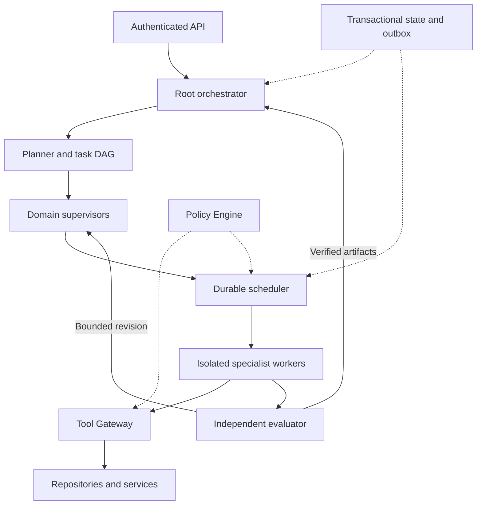

# RUSA-AI hierarchical autonomous agent architecture

Status: target design, not a claim of implemented enterprise functionality.
Repository: StrategyG/RusaAi. Task: RUSA-ARCH-001.

## Scope and autonomy

RUSA-AI is the target model/product. The agent control plane is a separate layer
around its future model runtime. Neither configuration files nor orchestration
create trained weights. No external model API is mandatory in this design.
Full autonomy applies inside previously authorized policy scopes; the repository
currently requires explicit human approval for production promotion, deployment,
secret changes, permission changes and destructive actions. Agent output cannot
change that policy.

## Components



Root owns run objectives and acceptance criteria; Planner proposes a finite DAG;
supervisors own domain tasks and integration; specialists perform bounded work;
Evaluator verifies artifacts independently. Workers execute one leased task at a
time and do not grant their own permissions. Simpler tasks may bypass unnecessary
supervisor layers. Every decomposition has a maximum depth, task count and budget.

## Incremental directory map

Keep the existing `llm-project/` model blueprint and API while introducing:

```text
rusa_agent/
  contracts/       # Versioned run/task/event/artifact models
  orchestrator/    # Run lifecycle and DAG validation
  supervisors/    # Engineering, research, data, operations
  workers/        # Lease lifecycle and isolated execution
  policy/         # Server-owned authorization and budget rules
  tools/          # Typed adapters behind Tool Gateway
  memory/         # Tenant-filtered retrieval and retention
  evaluation/     # Acceptance gates and evidence verification
  storage/        # Transactions, migrations, outbox, artifact metadata
  telemetry/      # Structured logs, traces, metrics, redaction
schemas/runtime/  # New runtime contract, separate from A2A handoff v1
policies/         # Reviewed policy versions
infra/            # Deployment manifests and monitoring
evaluations/     # Versioned benchmark datasets and rubrics
```

Do not split into independent network services until scaling or isolation requires
it. Start with explicit module boundaries, then deploy scheduler, worker, API and
evaluator separately. The existing A2A v1 schema is a collaboration handoff
contract; it lacks tenant, lease, budget and hierarchical runtime fields. Do not
silently reinterpret it as the enterprise runtime protocol.

## Communication contract

Runtime v1 events require schema_version, event_id, tenant_id, run_id, task_id,
parent_task_id (nullable), trace_id, type, timestamp, producer, attempt,
idempotency_key, payload and artifact references. Identity and tenant come from
verified credentials; task input may not choose a more privileged tenant.
Capabilities reference server-issued grants bound to actor, tenant, task,
resource, action, expiry and policy version.

Use asynchronous events for assignment/status/cancellation/result and synchronous
calls for policy decisions. Persist state changes and outbox events in the same
transaction. Consumers deduplicate event IDs. Large artifacts live in object
storage with content hash, size, media type, owner and access scope. Agent reports
contain concise decisions and evidence; no private reasoning transcript is needed.

## Orchestration and recovery

Task states: pending -> ready -> running -> validating -> succeeded. Failure paths:
running -> retry_wait -> ready, or failed; validating -> ready only within the
revision budget. Any nonterminal task can enter cancelling, then cancelled once
execution is stopped or fenced. Unknown external effects enter reconciliation,
not automatic replay.

Validate DAG cycles, unknown dependencies and cross-tenant references before
submission. Claim tasks transactionally with lease expiry and monotonically
increasing fencing tokens. Heartbeats renew leases. Only the current token may
commit state/artifacts. Use bounded retry with jitter for transient failures;
permanent policy/input failures do not retry. Cancel children and prevent new
assignments when a run is cancelled. Define dependency-failure propagation.

Assume at-least-once delivery. Exactly-once external effects are not promised.
Persist action intent and provider idempotency key before invocation; reconcile
ambiguous results before retry. Compensation requires its own authorization.
Each code task uses an isolated worktree; integration is serialized and retested.

Reserve worst-case permitted execution cost transactionally before dispatch,
settle actual usage after completion, and release reservations only after fenced
termination. Apply per-tenant quotas, queue fairness and backpressure. A kill switch
must block new grants and stop/fence active execution.

## Memory

Transactional database: authoritative runs, tasks, grants, budget reservations,
leases and outbox. Cache: disposable context with TTL, never authoritative leases.
Object storage: immutable artifacts. Search index: derived semantic/episodic memory.
Versioned repository: approved procedural memory. Restricted append-only audit:
actions, policy decisions, resource references and outcomes.

Every read/write is scoped by authenticated tenant and ACL. Enforce access before
retrieval, including vector search, caches and artifact URLs. Store provenance,
source version, freshness and verification status. Never embed secrets. Untrusted
retrieved text cannot modify policy. Deletion propagates to indexes and caches;
backup retention and legal requirements need an explicit organization policy.

## Tools

Tool Gateway enforces typed input/output, capabilities, destination allowlists,
timeouts, output limits, budget and side-effect classification. Workers use
restricted filesystem/network access and ephemeral credentials. Local sandboxing
must be verified before shell execution is enabled. Read-only adapters precede
write adapters. Remote content is data, never a source of administrative authority.

## Evaluation and release

Deterministic contract, functional and security gates precede model-assisted quality
judgment. The evaluator retrieves test outputs and artifact hashes; it must not
accept an implementer's success claim as evidence. Tests and acceptance criteria
cannot be weakened by the same task under evaluation. Mandatory security failures
cannot be averaged away by a quality score.

Track verified success rate, false-success rate, task latency, cost per success,
retry rate, duplicate effects and tenant isolation violations. Record model,
prompt, policy, code, tool and dataset versions. Choose latency/throughput targets
only after defining workload and baseline; no arbitrary production score.

## Delivery stages and acceptance

1. API foundation: fail-closed auth/schema, accurate readiness and regression tests.
2. Runtime contracts: versioning, finite DAG validation, tenant binding and state transitions.
3. Durable scheduler: concurrency, lease expiry, stale-worker fencing, outbox recovery,
   atomic budget reservation and restart tests against the actual database.
4. Tool runtime: sandbox escape tests, credential isolation, idempotency, cancellation
   and ambiguous-effect reconciliation with read-only tools first.
5. Hierarchical agents and memory: bounded delegation, tenant-isolation tests,
   independently verified artifacts and retrieval provenance.
6. Model integration: real weights/runtime identity, quality dataset, latency and
   resource evidence; no mock output may satisfy inference readiness.
7. Production: staging load tests, failure injection, backup/restore, rollback,
   alerts/runbooks and policy-authorized promotion.

Stages 2-7 are not implemented by the API foundation change. Infrastructure,
model artifacts, tenant identity provider, workload/SLO and budget policy remain
required deployment inputs.
